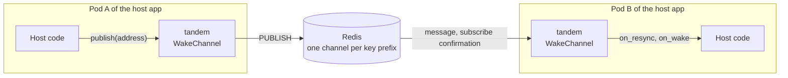
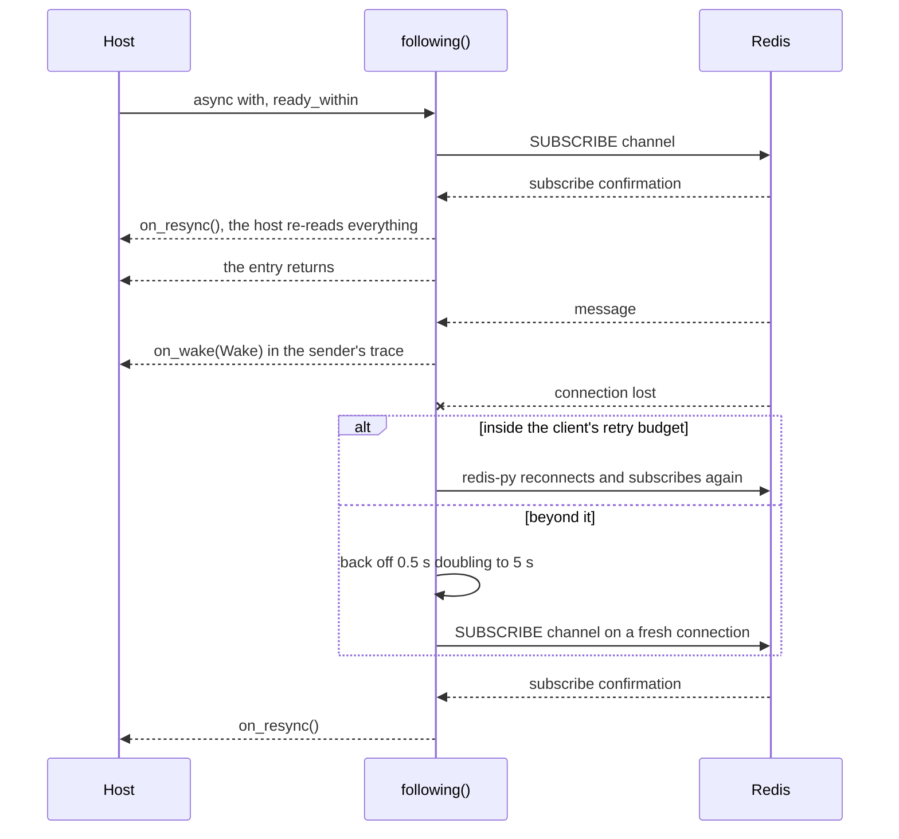
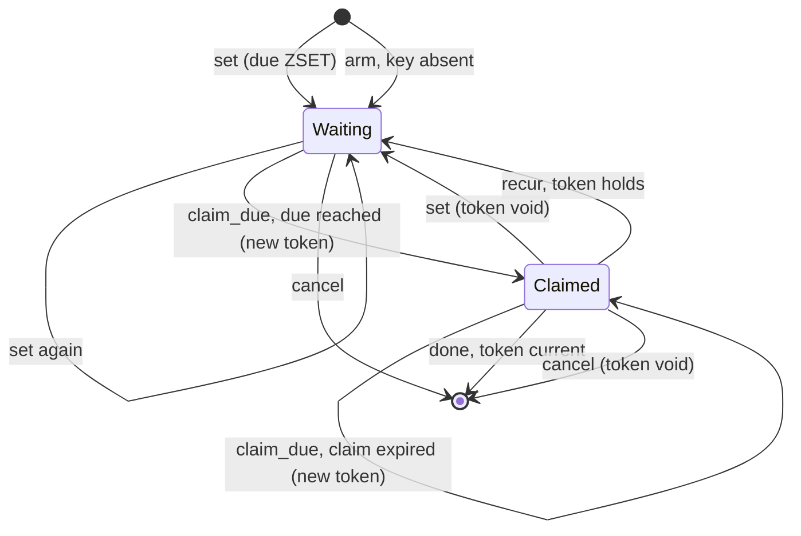
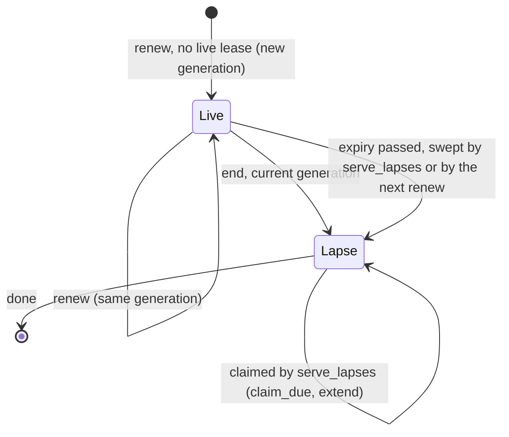
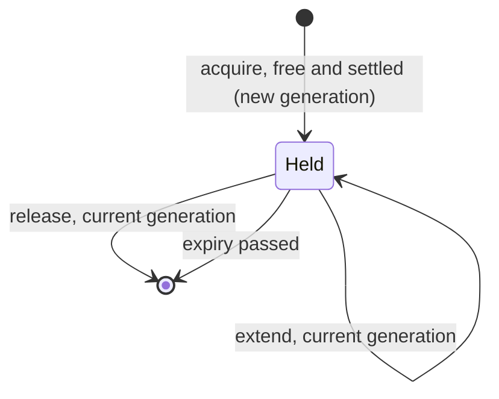

# tandem architecture

## 1. Context and Scope

tandem runs inside each pod of a host app, with no server or storage of its own; its one neighbour is the
Redis the host already uses, whose clock (`TIME`) stamps every deadline and lease. Host developers start at
the [README](../README.md) and the [reference](reference.md).

Outside: the host, which owns its state, its Redis client (pool, retry, timeouts) and what an address means,
and Redis, which keeps no wake. tandem imports only `redis` and `logline` (the fleet's logger: a version
range by name in tandem, whose tag the host pins); an import contract keeps test tools out of it.

## 2. Building Block View

Module owners in `tandem`:

- `wake` owns `WakeChannel` and `Wake`: the `PUBLISH`, the frame of a payload, the pub/sub connection of each
  `following`, the back-off loop around it and what a host would otherwise write around that loop:
  readiness, the bounded start, the serialised handling, the sender's trace and the split of a failure before
  and after the entry.
- `deadlines` owns `Deadlines` and `Due`: the deadline scripts, the claim tokens and the serving loop over any
  deadline queue (`serve_due`): the batches, the claim extension while a handler runs, `done`, the back-off and
  the lines of a round and a handling. It also owns what every repeating background run of tandem writes (its
  first failure and its recovery, which the serving loop shares) and the loop that repeats an attempt until it
  is stopped, which `kept` and `held` share.
- `leases` owns `Leases` and its records: the renew, end, state, live and sweep scripts, the loop of `kept`
  and the sweep and the lapse lines of `serve_lapses`. Its lapse queue is a `DeadlineQueue` of `deadlines`
  (the transitions of `Deadlines` over any three keys), and `serve_lapses` runs the loop of `deadlines` on it,
  so a lapse is claimed, extended and finished like a deadline; `leases` imports `deadlines`, never the
  reverse.
- `locks` owns `Locks`, `LockState` and `LockLost`: the acquire, extend, release and state scripts, the
  generations and the keeper of `held`. It shares the app's epoch and `Liveness`, and the shielded exit of
  `kept` (`finished_despite_cancellation`), with `leases` and has no lapse queue.
- `slots` owns `Slots`: the take and release scripts and the slot tokens. It is no extension of `locks`: a
  lock does exclusion with fencing and the epoch, a slot counts holders per pool and reads no epoch.
- `lua` owns `LUA_KIT`, the one implementation of each transition that the classes and a host's script run;
  `script` owns `Script`, which prepends it, runs by SHA and reloads on `NOSCRIPT`; `client` owns `Client`.
- `keys` owns every name tandem gives in Redis and the check of a key prefix and a kind.
- `testing` owns `aged_epoch` with `EpochSet`, which own the epoch's value, `settle_epoch`, which builds on them,
  and the in-memory wake channel (`FakeWakeBus`, `FakeWakeChannel`), the helpers for a host's tests; `__all__` lists the module, so they are public. The fake extends `wake`'s one base of
  `following`, so a host's tests run the real handler dispatch, and the `following` cells run against it and
  against Redis alike, so a drift fails tandem's CI.
- `errors` owns `StoreError`, the one mapping of a Redis failure onto it, its classification as an outage or
  a refusal, and the back-off of the following and of the serving loops.

## 3. Runtime View

A deadline is in one of three places; every arrow is one Lua script on Redis `TIME`:

Per kind there are a due ZSET scored by the due time in ms, a claimed ZSET scored by the claim's expiry and
a HASH from key to the current token. A claim is valid exactly while its token is the current one, so `set`,
`cancel` and a takeover void the old claim in the script that moves the key. `arm` moves only an absent key
and never voids a claim; `recur` ends a claim and arms the key in one script, so the key is never absent.

A lease is in the expiry ZSET while it lives and its generation is in a HASH. Every lease script reads
`TIME`, sets the epoch when absent and reads the lease state, so these are one snapshot:

`state` writes only the epoch: a lapse in any state is GONE, or UNKNOWN until `lasts` have passed since
the epoch.

A lock is one ZSET member scored by its expiry and one HASH field holding its generation; every lock
script starts with `tandem.lock_state`, so a host's admit script that calls it takes the same snapshot:

An absent lock reads free only once `lasts` have passed since the epoch; before that `acquire` returns None.

A slot family is one ZSET of every live hold, scored by its expiry; a hold's member is the JSON of its
random part followed by its pools. A take prunes the expired members, counts the live ones per pool,
refuses when any pool is at its cap and else adds its member, in one script; a release removes the member.

## 4. Deployment View

A library in the host's environment, installed by a pinned git tag; nothing of tandem is deployed or run.

## 5. Crosscutting Concepts

**Trust.** The host, its Redis and the other pods of the app are trusted; Redis's own ACL decides who may
publish and subscribe. The channel carries addresses, never contents: whoever can publish can make every
pod re-read, and nothing more.

**Failure.** Every failure of Redis is a `StoreError` that says whether it was an outage or a refusal;
the serving loops (`serve_lapses`, `serve_due`) ride out an outage and a refusal alike, as failed rounds with a
back-off, and end only when cancelled, and `kept` and `held` ride out a failed background call the same way, retried
after `every`, while `following` rides out an outage and ends on a refusal, which is its
`on_failed` contract; `publish` says nothing of whether the wake arrived. The [reference](reference.md) says how a failure reaches the host.

**Logging.** Every log point writes through logline's event contract on a standard-library logger
`tandem.<module>`: a literal `<noun>.<verb_past>` event with its fields in `extra=`. logline's `StepTimer`
times `publish`, each lease call, each lock call and each slot call, and each round and each handling of both
serving loops, a round only when it writes a line; Deadlines' transitions and `Script.run` write no line. A round
that claimed nothing writes a line only as the first failure of a run of failed rounds or as the recovery after one,
so an outage or a refusal costs two lines, not one per round per pod; the background renewals of `kept` and the
background extensions of `held` follow the same rule, a first failure and a recovery. A claim extension writes no line: the handling's own line says `claim_kept`
false when its claim was lost or may have run out. A failed handler's traceback is a line of its own,
`lapse_handler.failed` or `deadline_handler.failed`, because a step line never carries one.
tandem never calls `configure` or structlog: the host owns the process's logging. No line carries a
generation, a value that can end a lease, or a slot's pool or token. Each round and each handling of a
serving loop runs in its own trace (`unit_trace`), so the lines of a handling and the host handler's share a `trace_id`, and, from logline
v1.9.0, a step the handler opens hangs under the handling's span. The [reference](reference.md#what-tandem-logs) lists the
events; they are public.

**Proof strategy.** The tests run every cell against a real Redis, and the cells of the plain flow also run
on fakeredis, the `following` cells also on the in-memory wake channel of `tandem.testing`; the lowest direct
dependency floors run the same tests. Branch coverage is 100 %, measured over all tests. `AGENTS.md` names
the commands and the rules for waits and outages.

## 6. Constraints and reasons

- Each `following` opens one pub/sub connection of its own from the host's client: a subscribed connection
  cannot run other commands. On leaving the context it cancels and awaits its reader, which unsubscribes and
  closes the connection.
- `on_resync` is called for every `subscribe` confirmation Redis sends, including the one redis-py's own
  re-subscription triggers inside the client's retry budget; both redis-py versions CI runs deliver it through
  `get_message`, so tandem never changes the host's client settings, pool or `Retry`.
- `publish` is one `PUBLISH` under the host client's own `Retry`, never queued: a queued wake would outlive
  the state it describes, and tandem has no client of its own, so the host's retry, pool and timeouts
  govern it as they govern every other command. A retry cannot tell a lost request from a lost reply, so a
  wake can arrive twice, and a duplicate is harmless because a wake names what changed, never its
  content; the [reference](reference.md) says when `publish` ends.
- The wake payload is a frame that carries the sender's traceparent beside the address. The handlers are
  synchronous and `following` runs them on its one reader task, in `unit_trace`, so handling is one at a time
  in Redis's order and a trace ends with its call. The channel's version segment is a contract between pods
  of different releases; the [reference](reference.md#redis-layout-and-retries) states the frame and what a
  change costs a host.
- `held` cancels the task that entered its block, as `asyncio.timeout` does, so a host's own `try` and cleanup
  run as they do for any cancellation, and it repeats the cancel every `every` until the block ends, because a
  cancel scope inside the block, or a handler that swallows `CancelledError`, can absorb one. It
  withdraws each cancel it delivered at the exit and raises `LockLost` only when no cancel of the host's
  remains, so neither the host's cancellation nor an inner `asyncio.timeout` is turned into something else.
  That needs entry and exit in one task; a block that enters through another task passes
  `cancel_on_loss=False` and fences itself.
- Every transition of a deadline, lease, lock or slot is one Lua script that reads `TIME`, so no pod clock is
  involved and a transition cannot interleave with another.
- A deadline key or lock name is a ZSET member and a HASH field, never a key segment, so a free-form value
  cannot reach a fixed key. A slot's pools live only inside its member, never in a key segment. The segment
  after `v1` is one of the fixed tokens `epoch`, `d`, `l`, `lock` and `slot`, and a caller's `kind` or `family`
  appears only after its token and before a fixed suffix.
- Generations, claim tokens and the random part of a slot token are 128 random bits from `secrets`, generated in Python because Lua's random is
  not fit, compared by equality and never ordered, so no counter is needed that a Redis restart would reset;
  the collision bound is accepted.
- The epoch is created by `SET NX` inside every lease and lock script, so UNKNOWN ends at most `lasts` after
  the first command after a restart, with no separate initialisation and no race between pods. The grace
  works only when the epoch is lost together with the leases and locks it guards: a Redis that forgets some
  keys and keeps the epoch (an eviction, a partial restore) reads a lost lock as free, and two holders can
  then be live together. The guarantee holds on a Redis that forgets all or nothing: one instance, never a
  replica (it can lag behind the epoch or the locks) and never a partial snapshot.
- `Slots` reads and writes no epoch: after a Redis restart takes are granted at once, so a cap can be
  exceeded by the lost holds for at most `lasts`. The epoch guards exclusion, where two holders are a fault;
  a load cap tolerates a bounded overshoot, and an epoch would refuse every take for `lasts` after a restart.
- A lock is not a lease: `Leases.renew` extends a live lease for any caller, so a lock built on it would be
  held for ever by the losers that keep polling; `extend` needs the generation.
- `tandem.lock_state` returns nil for a free lock, so `if tandem.lock_state(...) then` fails closed: a held
  lock and an unsettled epoch both refuse, in one atomic step with the host's write.
- A lapse leaves the expiry ZSET for the lapse queue in the script that notices it, so a claim on a lapse
  never touches the expiry that decides ALIVE. The serving loop extends every pending claim of its batch, in
  `serve_lapses` and `serve_due` alike, so the claims of a mass lapse or of many due keys do not run out while
  earlier handlers run.
- Scripts run through the host's client, so its `Retry` can replay one after a lost reply; the
  [reference](reference.md#redis-layout-and-retries) says what a replay does.

## 7. Not chosen

- Redis Streams: they keep history and need consumer groups, offsets and trimming; a re-read at
  `on_resync` already restores any state a lost wake described.
- One channel per address: the channels grow with the data and every reconnect resubscribes them all.
- A heartbeat of tandem's: it reopens if a host meets a silent half-open connection in operation.

## 8. Risks and Technical Debt

- Redis pub/sub is at most once: a wake published while a subscription is down is lost, and only the host's
  re-read at `on_resync` and its handling of a failed `publish` bring the pods back in line.
- From redis-py 8.2 the reader blocks in a read with no timeout, as redis-py's pub/sub does, so a connection
  that dies without closing is noticed late; below 8.0.1 the read ends at the client's `socket_timeout` and the
  reader subscribes again. `on_resync` and `on_wake` run one at a time in Redis's order, so a slow
  synchronous handler holds every later wake and a long first re-read delays the entry's return.
