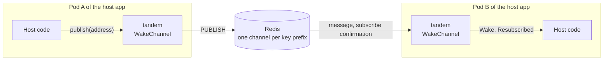
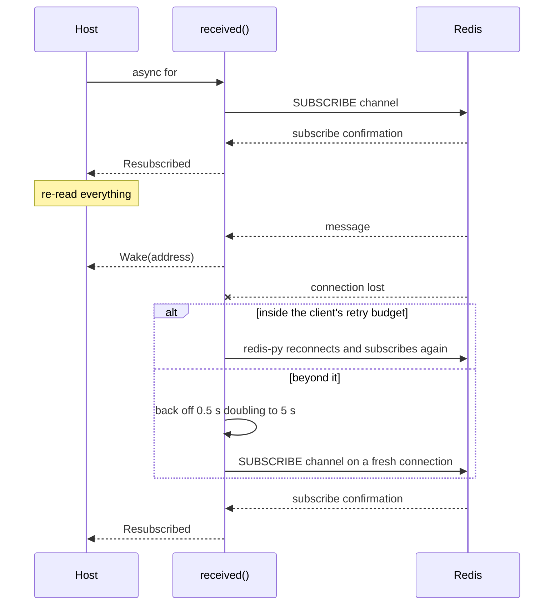
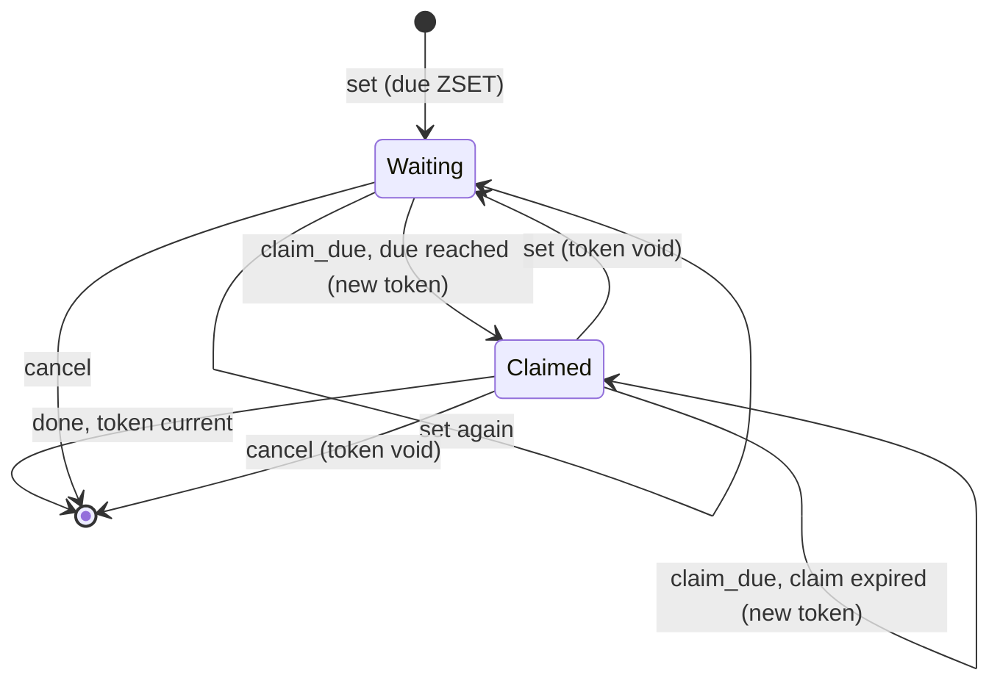
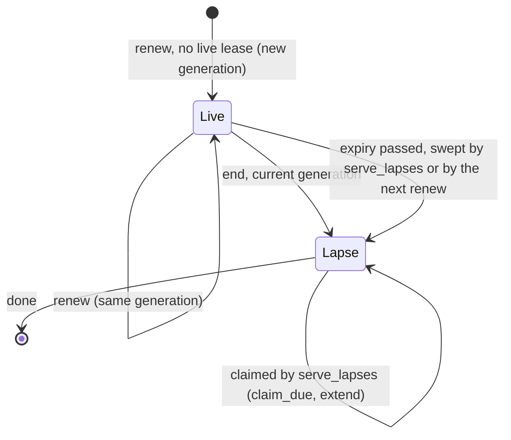

# tandem architecture

## 1. Context and Scope

tandem runs inside each pod of a host app, with no server or storage of its own; its one neighbour is the
Redis the host already uses, whose clock (`TIME`) stamps every deadline and lease. Host developers start at the [README](../README.md).

Outside: the host, which owns its state, its Redis client (pool, retry, timeouts) and what an address means,
and Redis, which keeps no wake. tandem imports only `redis`; an import contract keeps test tools out of it.

## 2. Building Block View

Module owners in `tandem`:

- `wake` owns `WakeChannel`, `Wake` and `Resubscribed`: the `PUBLISH`, the dedicated pub/sub connection of
  each `received()`, the translation of Redis's messages into events and the back-off loop around them.
- `deadlines` owns `Deadlines` and `Due`: the claim, extend and done scripts and the claim tokens, which it
  generates in Python because Lua's random is not fit.
- `leases` owns `Leases`, `Liveness`, `Renewal`, `Lapse`, `Roster` and `Hold`: the renew, end, liveness, live
  and sweep scripts and the loops of `kept` and `serve_lapses`. Its lapse queue is a `DeadlineQueue` of
  `deadlines` (the transitions of `Deadlines` over any three keys), so a lapse is claimed, extended and
  finished by the same scripts as a deadline.
- `lua` owns `LUA_KIT`: the one implementation of each transition that both `Deadlines` and a host's script
  run (`now_ms`, `deadline_set`, `deadline_cancel`, `deadline_state`, `wake`).
- `script` owns `Script`: it prepends `LUA_KIT`, runs by SHA and reloads on `NOSCRIPT`.
- `client` owns the exported `Client` type.
- `keys` owns the names tandem gives in Redis: the check of a key prefix and a kind, the wake channel and the
  `DeadlineKeys` of a kind and the `LeaseKeys` of a family.
- `errors` owns `StoreError`, the one mapping of a Redis failure onto it, its classification as an outage
  (a lost connection or a timeout) or a refusal, and the back-off both loops use.
- `tests/support` owns the test tools: a TCP proxy that cuts, holds and black-holes the way to Redis, a
  reader that steps through events, and a minimal host.

`wake` and `script` use `client` and `errors`; `deadlines` uses `script` and `keys`; `leases` uses `deadlines`, `script`,
`keys` and `errors`; `script` uses `lua`. Anything
that is the name of a Redis key or channel is built in `keys`.

## 3. Runtime View

A deadline is in one of three places, and every arrow is one Lua script on Redis `TIME`:

Per kind there are three structures: a due ZSET scored by the due time in ms on `TIME`, a claimed ZSET scored
by the claim's expiry and a HASH from key to the current token. Because the HASH holds one token per key, a
claim is valid exactly while its token is the current one, so `set`, `cancel` and a takeover void the old
claim by replacing or deleting that token, in the same script that moves the key.

A lease is in the expiry ZSET while it lives; its generation is in a HASH. Every lease script starts by
reading `TIME`, setting the epoch when absent and reading the lease state, so these are one snapshot:

`liveness` reads the expiry ZSET alone: a lapse in any state is GONE (or UNKNOWN until `lasts` have passed since
the epoch, which the first lease command after a Redis restart creates).

## 4. Deployment View

A library in the host's environment. The host installs it by a pinned git tag and builds a `WakeChannel` on
the Redis client it already has; there is nothing of tandem to deploy or run.

## 5. Crosscutting Concepts

**Trust.** The host, its Redis and the other pods of the app are trusted; Redis's own ACL decides who may
publish and subscribe. The channel carries addresses, never contents: whoever can publish can make every
pod re-read, and nothing more. A Redis that refuses a command (an ACL denial, an out-of-memory refusal)
surfaces as `StoreError`.

**Failure.** Every failure of Redis, in `publish`, `received()`, `Deadlines`, `Leases` and `Script`, is a `StoreError`
that says whether it was an outage or a refusal; `received()`, `serve_lapses` and `kept` ride out an outage
and end, or raise, on a refusal;
`publish` says nothing of whether the wake arrived.
`received()` survives every connection failure and ends only on cancellation or a refusal;
a payload that is no valid UTF-8 is skipped and logged by length.

**Proof strategy.** The tests run every cell against a real Redis in a throwaway container started by
`scripts/run_redis_tests.sh`; the cells that need an outage go through a small TCP proxy, and the cells of
the plain flow also run on fakeredis. Waits are barriers and bounded waits, never sleeps; a stimulus that is
time itself waits on the loop clock. Branch coverage is 100 %, measured over all tests. The lowest direct
dependency floors run the same tests.

## 6. Constraints and reasons

- Each `received()` opens one pub/sub connection of its own from the host's client: a subscribed connection
  cannot run other commands, and two readers must not share a subscription's lifetime.
- `Resubscribed` is yielded for every `subscribe` confirmation Redis sends, including the one redis-py's own
  re-subscription triggers inside the client's retry budget. redis-py 8.1 delivers that confirmation through
  `get_message`, so tandem never copies the host's client settings and never changes the host's pool or
  `Retry`.
- `publish` is one `PUBLISH` with no retry or queue, neither tandem's nor the host client's `Retry`: a queued
  wake would outlive the state it describes, and a retry cannot tell a lost request from a lost reply. It
  borrows a connection from the host's pool and sends the one command itself. The host client's `Retry` still
  governs the connecting and health check before the command, because the pool's connections carry it and
  tandem does not change them; no `PUBLISH` has been sent at that point, so it cannot duplicate a wake. With an
  unreachable Redis `publish` therefore blocks for about the `Retry`'s total plus each attempt's connect
  timeout. Because it bypasses the client's `execute_command`, a `publish` is absent from redis-py's
  operation-duration and error-count metrics.
- The prefix is one segment checked at construction: a prefix with `:` would make the segments of a channel name
  ambiguous, and a wrong value must fail where it is written.
- On cancellation `received()` unsubscribes and closes its connection, so a cancelled reader leaves no
  subscriber and no connection behind.

- Every deadline transition is one Lua script that reads `TIME`, so no pod clock is involved and a transition
  cannot interleave with another. Redis does not roll a script back: a script that fails after a write keeps
  the write, so a script checks before it writes.
- A deadline key is a ZSET member and a HASH field, never a key segment, so a free-form key cannot reach a
  fixed key. The segment after `v1` is one of the fixed tokens `wake`, `epoch`, `d` and `l`, and a caller's
  `kind` appears only after `d:` and before a fixed suffix.
- The generation of a lease is 128 random bits from `secrets`, compared by equality, not ordered: it needs
  no counter that a Redis restart would reset. Its collision bound is accepted. The epoch is created by
  `SET NX` inside every lease script, so UNKNOWN ends at most `lasts` after the first lease command after a
  restart, with no separate initialisation and no race between pods.
- A lapse leaves the expiry ZSET for the lapse queue in the script that notices it (a renew, an end or the
  sweep), so a claim on a lapse never touches the expiry that decides ALIVE.
- `serve_lapses` claims small batches and extends every pending claim of the batch, so the claims of a mass
  lapse do not run out while earlier handlers run.
- Tokens are 128 random bits from `secrets`, generated in Python and passed as arguments, since Lua's random
  is not fit for them. Each claim gets a fresh one.
- Scripts run through the host's client, so its `Retry` can run one again after a lost reply. A replay is
  harmless only while nothing else touched the key in between: `set` replaces the due time and invalidates
  any claim, and `cancel` removes whatever the key currently is, and neither tells a replay from a new
  operation. A retried `cancel` can therefore delete a deadline another pod armed after the first `cancel`
  ran, and a retried `set` can overwrite a newer due time or invalidate a newer claim. `extend` repeats
  harmlessly, since it needs the token. A claim whose reply is lost expires and is claimed again, which
  keeps "at least once"; a repeated `done` answers False although the first finished.

## 7. Not chosen

- Redis Streams: they keep history and need consumer groups, offsets and trimming; a re-read at
  `Resubscribed` already restores any state a lost wake described.
- One channel per address: the number of channels grows with the data and every reconnect must resubscribe
  them all.
- A heartbeat of tandem's: a silent half-open connection stays undetected until the system reports it. It
  reopens if a host meets one in operation.

## 8. Risks and Technical Debt

- A Redis restart takes every deadline, lease, lapse and claim with it; the host's reconcile pass sets them
  again, and an absent lease reads UNKNOWN for `lasts`.
- A family without `serve_lapses` keeps its lapse queue until the next restart; a lapse whose handler always
  raises returns every `claim_for`.
- Redis pub/sub is at most once: a wake published while a pod's subscription is down is lost, and only the
  host's re-read at `Resubscribed` and its handling of a failed `publish` bring the pods back in line.
- `received()` blocks in a read with no timeout, as redis-py's pub/sub does, so a connection that dies
  without closing is noticed late.
- A `Resubscribed` and a wake reach the host in Redis's order, but a host that handles events concurrently
  can re-read out of order; the host serialises its handling.
