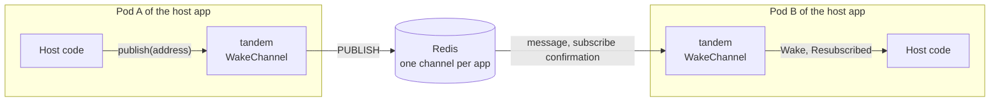
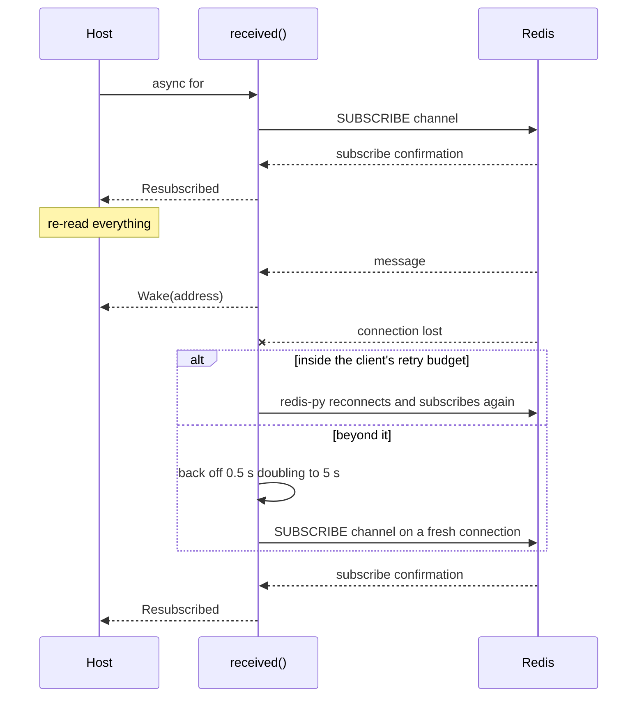

# tandem architecture

## 1. Context and Scope

tandem runs inside each pod of a host app, with no server or storage of its own; its one neighbour is the
Redis the host already uses. Host developers start at the [README](../README.md).

Outside: the host, which owns its state, its Redis client (pool, retry, timeouts) and what an address means,
and Redis, which keeps no wake. tandem imports only `redis`; an import contract keeps test tools out of it.

## 2. Building Block View

Module owners in `tandem`:

- `wake` owns `WakeChannel`, `Wake` and `Resubscribed`: the `PUBLISH`, the dedicated pub/sub connection of
  each `received()`, the translation of Redis's messages into events and the back-off loop around them.
- `keys` owns the names tandem gives in Redis: the check of a key prefix and the wake channel built from it.
- `errors` owns `StoreError`.
- `tests/support` owns the test tools: a TCP proxy that cuts, holds and black-holes the way to Redis, a
  reader that steps through events, and a minimal host.

`wake` uses `keys` and `errors`. Anything that is the name of a Redis key or channel is built in `keys`.

## 3. Runtime View

## 4. Deployment View

A library in the host's environment. The host installs it by a pinned git tag and builds a `WakeChannel` on
the Redis client it already has; there is nothing of tandem to deploy or run.

## 5. Crosscutting Concepts

**Trust.** The host, its Redis and the other pods of the app are trusted; Redis's own ACL decides who may
publish and subscribe. The channel carries addresses, never contents: whoever can publish can make every
pod re-read, and nothing more. A Redis that refuses a command (an ACL denial, an out-of-memory refusal)
surfaces as `StoreError`.

**Failure.** `publish` reports every failure as `StoreError` and says nothing of whether the wake arrived.
`received()` survives every connection failure and ends only on cancellation or a refusal.

**Proof strategy.** The tests run every cell against a real Redis in a throwaway container started by
`scripts/run_redis_tests.sh`; the cells that need an outage go through a small TCP proxy, and the cells of
the plain flow also run on fakeredis. Waits are barriers and bounded waits, never sleeps; a stimulus that is
time itself waits on the loop clock. Branch coverage is 100 %, measured over all tests. The lowest direct
dependency floors run the same tests.

## 6. Constraints and reasons

- Each `received()` opens one pub/sub connection of its own from the host's client: a subscribed connection
  cannot run other commands, and two readers must not share a subscription's lifetime.
- `Resubscribed` is yielded for every `subscribe` confirmation Redis sends, including the one redis-py's own
  re-subscription triggers inside the client's retry budget. redis-py 8.1 delivers that confirmation through
  `get_message`, so tandem never copies the host's client settings and never changes the host's pool or
  `Retry`.
- `publish` is one `PUBLISH` with no retry or queue, neither tandem's nor the host client's `Retry`: a queued
  wake would outlive the state it describes, and a retry cannot tell a lost request from a lost reply. It
  borrows a connection from the host's pool and sends the one command itself. The host client's `Retry` still
  governs the connecting and health check before the command, because the pool's connections carry it and
  tandem does not change them; no `PUBLISH` has been sent at that point, so it cannot duplicate a wake.
- The prefix is one segment checked at construction: a prefix with `:` would make the segments of a channel name
  ambiguous, and a wrong value must fail where it is written.
- On cancellation `received()` unsubscribes and closes its connection, so a cancelled reader leaves no
  subscriber and no connection behind.

## 7. Not chosen

- Redis Streams: they keep history and need consumer groups, offsets and trimming; a re-read at
  `Resubscribed` already restores any state a lost wake described.
- One channel per address: the number of channels grows with the data and every reconnect must resubscribe
  them all.
- A heartbeat of tandem's: a silent half-open connection stays undetected until the system reports it. It
  reopens if a host meets one in operation.

## 8. Risks and Technical Debt

- Redis pub/sub is at most once: a wake published while a pod's subscription is down is lost, and only the
  host's re-read at `Resubscribed` and its handling of a failed `publish` bring the pods back in line.
- `received()` blocks in a read with no timeout, as redis-py's pub/sub does, so a connection that dies
  without closing is noticed late.
- A `Resubscribed` and a wake reach the host in Redis's order, but a host that handles events concurrently
  can re-read out of order; the host serialises its handling.
